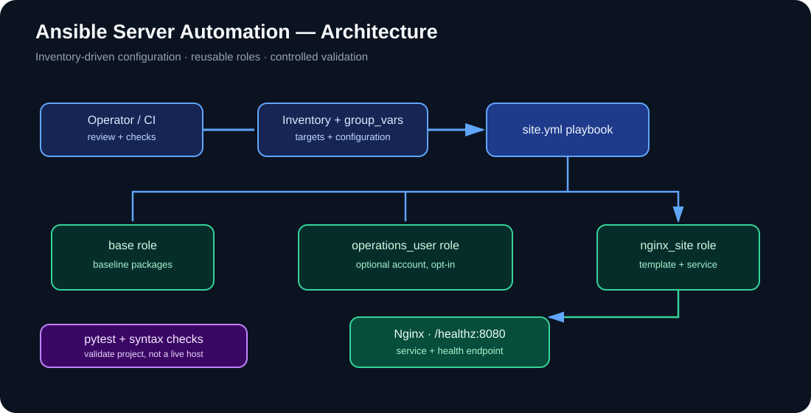
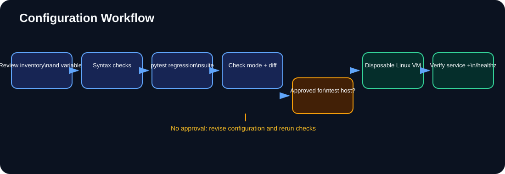

<div align="center">

# ⚙️ Ansible Server Automation

**Repeatable Linux baseline configuration and managed Nginx deployment with Ansible roles**

[](https://github.com/ABHILASH9519/Ansible-server-Automation/actions/workflows/ansible-checks.yml)


[Architecture](#-architecture) · [Workflow](#-configuration-workflow) · [Quick start](#-local-checks) · [Safe execution](#-safe-first-run)

</div>

---

A role-based Ansible project for repeatable Linux baseline configuration and a managed Nginx landing page.

## ✨ Capabilities

- Reusable roles for base packages, optional operations user and Nginx site configuration
- Inventory-driven target selection and shared defaults
- Managed templates and handlers for configuration changes
- Health endpoint at `/healthz` on port 8080 by default
- Automated regression tests and Ansible syntax validation in GitHub Actions
- Documented check-mode, rollout and rollback practices

## 🧭 Architecture



[Open system architecture diagram](docs/images/system-architecture.svg)

## 🔄 Configuration workflow



[Open workflow diagram](docs/images/configuration-workflow.svg)

## 📊 Status and verification

The repository includes regression tests, YAML/playbook syntax checks and a documented safe-execution procedure. CI does **not** connect to or configure a real Linux host; a disposable-VM integration run remains a separate validation step.

## 🗂️ Project layout

- `inventories/` — local inventory and documentation-only production example
- `playbooks/site.yml` — applies the baseline, optional operations user and Nginx site roles
- `playbooks/validate.yml` — checks the resulting host configuration
- `roles/` — reusable Ansible roles
- `group_vars/all.yml` — shared defaults
- `tests/` — regression tests for structure, defaults, handlers and safe-execution docs
- `docs/` — architecture, deployment checklist and safe-execution/rollback runbook
- `.github/workflows/ansible-checks.yml` — CI tests and syntax checks

## 🧰 Requirements

- Python 3.10+
- Ansible Core and dependencies from `requirements.txt`
- SSH access and privilege escalation for remote Linux hosts

## ⚡ Local checks

```bash
python -m pip install -r requirements.txt pytest
python -m pytest -q
ansible-playbook -i inventories/local/hosts.yml playbooks/site.yml --syntax-check
ansible-playbook -i inventories/local/hosts.yml playbooks/validate.yml --syntax-check
```

## 🛡️ Safe first run

Use a disposable VM and review all variables before connecting to any host. Start with syntax validation, then use check mode where supported:

```bash
ansible-playbook -i inventories/production/hosts.yml.example playbooks/site.yml --syntax-check
ansible-playbook -i inventories/production/hosts.yml.example playbooks/site.yml --check --diff
```

The example inventory intentionally uses documentation-only addresses. Replace it with your own protected inventory before attempting a real run. Check mode is not a perfect simulation for every module.

Read [the safe execution and rollback runbook](docs/safe-execution.md) before applying changes. Never commit passwords, private keys, vault passwords or production inventory secrets.
