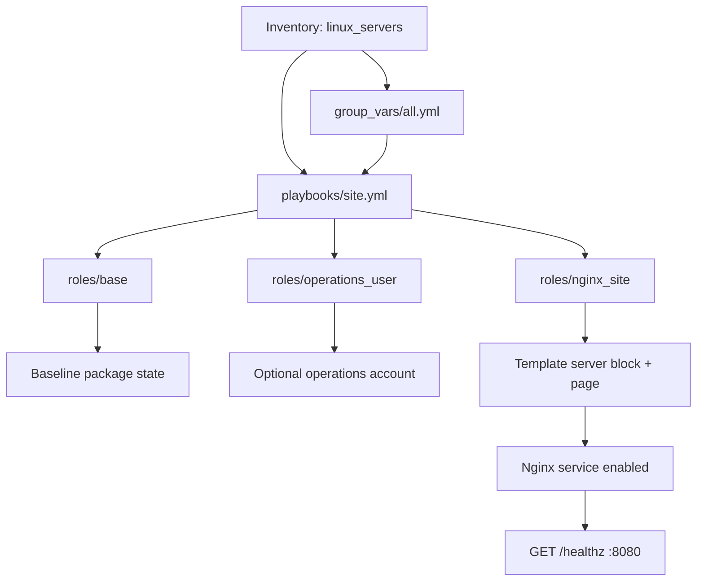
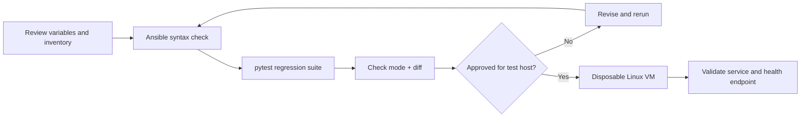

# Architecture

The `site.yml` playbook targets the `linux_servers` inventory group and applies three roles:

1. `base` installs a small baseline package set using the host's package manager.
2. `operations_user` creates an optional operations account only when explicitly enabled.
3. `nginx_site` installs Nginx, renders a static page and a managed server block, and ensures the service is enabled.

The Nginx site listens on `nginx_listen_port` (8080 by default) and exposes `/healthz` as a simple health endpoint. Review port exposure and firewall rules before deployment.

The default local inventory uses a local connection. It is intended for syntax and controlled local testing, not as proof that every task can safely run on a developer workstation.

## Role and configuration flow

## Validation and safe execution

## Role responsibilities

| Role | Responsibility |
|---|---|
| `base` | Baseline packages and supported operating-system checks |
| `operations_user` | Optional operations account controlled by explicit configuration |
| `nginx_site` | Nginx package, templated site configuration, service handler and health endpoint |

## Verification boundary

Automated tests and syntax checks do not prove a successful configuration on every Linux distribution. Validate against a disposable VM before using this project on a real host.
